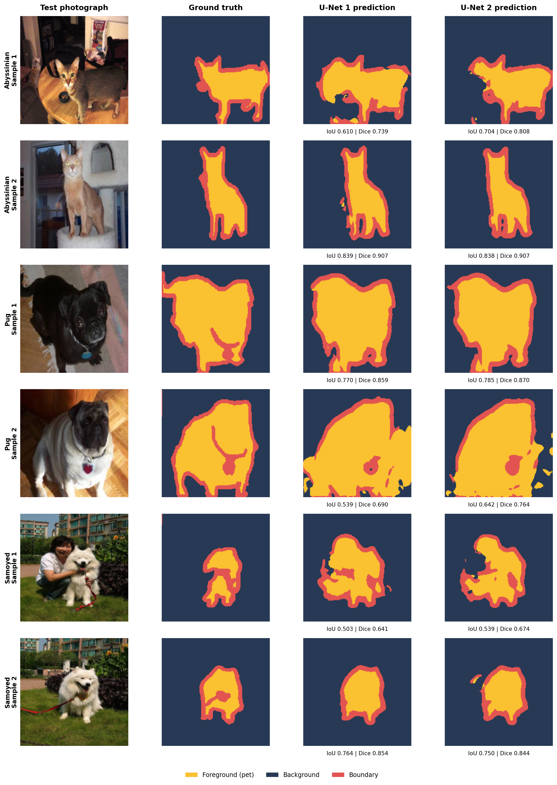
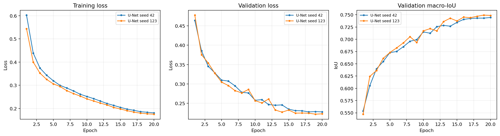
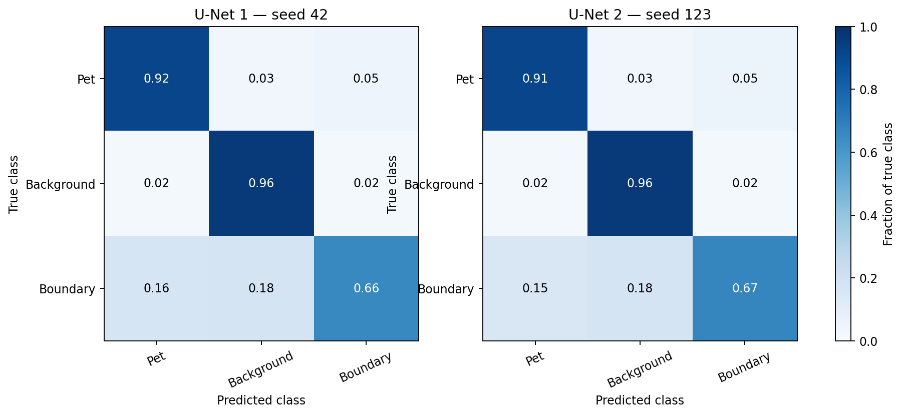

# Oxford-IIIT Pet Segmentation with U-Net

**Graduate-level image processing project · PyTorch · Semantic segmentation · Reproducible experiments**

This project implements a compact, U-Net-like encoder–decoder architecture for **three-class semantic segmentation** of pet photographs in the [Oxford-IIIT Pet dataset](https://www.robots.ox.ac.uk/~vgg/data/pets/). Two networks with identical architectures and training configurations are trained using different random seeds. Their predictions are evaluated with Intersection over Union (IoU) and the Dice coefficient on the **entire official test split**.

## Results

| Model | Random seed | Test macro IoU ↑ | Test macro Dice ↑ |
|---|---:|---:|---:|
| U-Net 1 | 42 | 0.7579 | 0.8524 |
| U-Net 2 | 123 | 0.7628 | 0.8557 |

*These values are recorded experimental outputs from the supplied executed notebook and results archive, not estimates. They are macro averages over the three segmentation classes, obtained from class-level confusion counts aggregated across all **3,669** test images.*

**Interpretation:** U-Net 2 was slightly stronger in this pair of runs. A difference between two random seeds is not, by itself, evidence of a statistically significant improvement. The boundary class was the most difficult class to segment accurately.

### Qualitative test predictions

Six held-out test images, with two examples each from **Abyssinian**, **Pug**, and **Samoyed**, show the original photograph, ground-truth mask, and predictions from both models.



### Training and validation curves



### Confusion matrices



## Dataset and problem formulation

- **Dataset:** [Oxford-IIIT Pet](https://www.robots.ox.ac.uk/~vgg/data/pets/), comprising 37 cat/dog breeds with pixel-level trimap annotations.
- **Split:** 3,311 training / 369 validation images, obtained by a fixed breed-stratified 90/10 split of the official `trainval` set; 3,669 images in the untouched official test set.
- **Segmentation targets:** pet foreground, background, and boundary. The trimap's boundary region is **retained as a third class** rather than ignored or merged.
- **Preprocessing:** resize images to 192 × 192 (bilinear) and masks with nearest-neighbor interpolation; normalize images; augment training examples with simple image transformations.

## Experimental setup

| Parameter | Value |
|---|---|
| Architecture | Lightweight U-Net-like encoder–decoder with skip connections |
| Input resolution | 192 × 192 |
| Base feature channels | 24 |
| Objective | Cross-entropy + soft Dice loss (equal weighting) |
| Optimizer | AdamW |
| Learning rate | 0.001 |
| Weight decay | 0.0001 |
| Batch size | 12 |
| Maximum epochs | 20 |
| Early stopping patience | 6 |
| Model seeds | 42 and 123 |
| Best checkpoint epochs | 20 and 19 |
| Evaluation | Global test confusion counts, per-class IoU/Dice, then macro averaging |

Both training runs use the same code, architecture, data split, loss and hyperparameters; the random seed changes between runs. Model selection is based on validation performance, with the official test set reserved for final evaluation.

## Reproduce the experiment

**Google Colab (recommended):**

1. Open [`Oxford_IIIT_Pet_UNet_Segmentation.ipynb`](Oxford_IIIT_Pet_UNet_Segmentation.ipynb) in [Google Colab](https://colab.research.google.com/).
2. Select **Runtime → Change runtime type → GPU** (for example, a T4).
3. Choose **Runtime → Run all**. The notebook downloads the Oxford-IIIT Pet dataset automatically via `torchvision.datasets.OxfordIIITPet`.
4. After the training and test cells finish, the notebook writes results into `pet_segmentation_results/` and generates `pet_segmentation_submission_results.zip`.

**Local Jupyter (optional):** Install compatible PyTorch and torchvision packages for your hardware, then run `pip install -r requirements.txt`, start Jupyter, and execute notebook cells in order. Using a CUDA GPU is strongly recommended for training.

The initial data download requires an internet connection. Re-running training can produce small numerical differences across hardware and framework versions, even when seeds are fixed.

## Repository structure

```text
Oxford-IIIT-Pet-UNet-Segmentation/
├── README.md
├── Oxford_IIIT_Pet_UNet_Segmentation.ipynb
├── requirements.txt
├── .gitignore
└── results/
    ├── experiment_configuration.json
    ├── final_model_comparison.csv
    ├── per_class_test_metrics.csv
    ├── per_test_image_metrics.csv
    ├── results_discussion.txt
    ├── six_qualitative_test_examples.png
    ├── test_confusion_matrices.png
    ├── training_curves.png
    └── training_history.csv
```

The repository includes the fully executed notebook and exported metrics/figures. The raw Oxford-IIIT Pet dataset and trained `.pt` weight checkpoints are **not included**; checkpoints can be regenerated by running the notebook.

## Limitations

- Two random seeds satisfy the controlled model-comparison objective, but are not enough to support a statistical claim of superiority.
- Boundary predictions are more challenging than large foreground/background regions.
- The recorded metrics use a three-class trimap protocol; values are not directly comparable to binary pet-versus-background segmentation scores without matching evaluation protocols.
- No claim is made that these are state-of-the-art segmentation results.

## References and attribution

1. O. M. Parkhi et al., *Cats and Dogs*, IEEE CVPR, 2012. https://doi.org/10.1109/CVPR.2012.6248092
2. University of Oxford Visual Geometry Group, [Oxford-IIIT Pet dataset](https://www.robots.ox.ac.uk/~vgg/data/pets/) (review the dataset's terms and attribution requirements before reuse).
3. O. Ronneberger, P. Fischer, T. Brox, *U-Net: Convolutional Networks for Biomedical Image Segmentation*, 2015. https://arxiv.org/abs/1505.04597
4. [Torchvision OxfordIIITPet dataset documentation](https://docs.pytorch.org/vision/stable/generated/torchvision.datasets.OxfordIIITPet.html)

*Developed as an advanced image processing coursework experiment. The original dataset and its annotations belong to their respective creators.*
